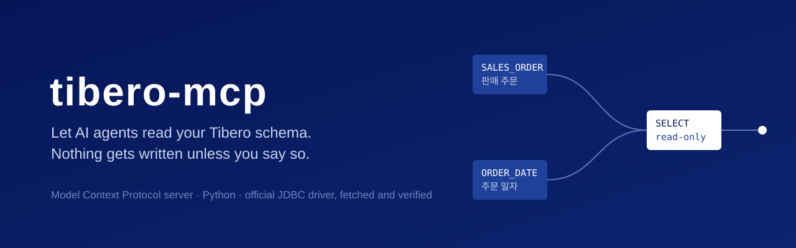

<p align="center">
  
</p>

<p align="center">
  <a href="https://github.com/jdk1021/tibero-mcp/actions/workflows/ci.yml"></a>
  
  
  
  <a href="LICENSE"></a>
</p>

<p align="center">
  <a href="https://jdk1021.github.io/tibero-mcp/?lang=ko">웹사이트</a> ·
  <a href="README.md">English</a> ·
  <a href="#빠른-시작">빠른 시작</a> ·
  <a href="#도구">도구</a> ·
  <a href="SECURITY.md">보안</a>
</p>

---

**tibero-mcp**는 Claude Code, Codex, Cursor 같은 AI 에이전트가 **Tibero** 데이터베이스를 탐색하고 조회할 수 있게 해 주는 [MCP(Model Context Protocol)](https://modelcontextprotocol.io) 서버입니다. 에이전트가 기업·공공기관 스키마를 다루는 실제 흐름에 맞췄습니다. 한글 주석으로 테이블을 찾고, 키 구조를 파악하고, 쿼리를 쓰고, 실행 계획을 확인하는 동안 데이터가 실수로 바뀌는 일은 없습니다.

## 특장점

**기본값이 안전합니다.** Tibero는 JDBC 읽기 전용 플래그를 무시하고 `SET TRANSACTION READ ONLY`도 지원하지 않습니다. 그래서 서버가 직접 막습니다. `SELECT`와 `WITH`만 실행하고, 한 번에 한 문장만 받으며, `SELECT … FOR UPDATE`를 거부하고, 조회할 때마다 롤백합니다. 쓰기 도구는 직접 켜기 전에는 아예 등록되지 않습니다.

**주석을 읽는 스키마 탐색.** 많은 Tibero 스키마에서 주석은 사실상 유일한 문서입니다. `주문`, `납기` 같은 주석으로 테이블과 컬럼을 검색하고, 한 번의 호출로 컬럼과 기본키·유니크키·외래키, 인덱스를 확인할 수 있습니다.

**에이전트가 바로 쓰는 결과.** 숫자는 숫자로, 날짜는 ISO 문자열로 바꾸고 LOB는 잘라서 JSON으로 돌려줍니다. 행 수 상한과 `truncated` 표시, 이어서 받을 위치를 알려 주는 `next_offset`, 문장 타임아웃이 있고, 실행 계획은 읽기 쉬운 트리로 보여 줍니다. 오류 메시지에는 다음에 시도할 일을 적어 줍니다.

**드라이버를 찾아다닐 필요가 없습니다.** TmaxTibero 공식 JDBC 드라이버([`com.tmaxtibero:tbjdbc8`](https://central.sonatype.com/artifact/com.tmaxtibero/tbjdbc8), Maven Central GPG 서명 배포)를 처음 실행할 때 내려받아 고정된 SHA-1로 검증하고 캐시합니다. 저장소에 독점 jar가 없고, `CLASSPATH`를 맞출 일도 없습니다.

**다른 에이전트와 함께 운영하기 좋습니다.** stdio와 Streamable HTTP를 지원하고, 연결이 끊기면 스스로 다시 연결하며, 클라이언트가 떠나면 프로세스가 깔끔하게 종료됩니다.

Tibero 6 서버와 7.2.6 드라이버 조합으로 검증했습니다.

## 빠른 시작

Python 3.12 이상, [uv](https://docs.astral.sh/uv/), Java 8 이상이 필요하고, 첫 실행 때 Maven Central에 접속할 수 있어야 합니다.

1. 내려받고 설정합니다.

   ```bash
   git clone https://github.com/jdk1021/tibero-mcp.git
   cd tibero-mcp
   cp env.example .env    # 호스트, DB 이름, 계정, 비밀번호
   uv sync
   ```

2. 클라이언트에 등록합니다. Claude Code:

   ```bash
   claude mcp add -s user tibero -- uv --directory /path/to/tibero-mcp run tibero-mcp
   ```

   Claude Desktop, Cursor처럼 JSON으로 설정하는 클라이언트에서는 `.env` 대신 env로 값을 넘길 수 있습니다.

   ```json
   {
     "mcpServers": {
       "tibero": {
         "command": "uv",
         "args": ["--directory", "/path/to/tibero-mcp", "run", "tibero-mcp"],
         "env": {
           "TIBERO_HOST": "db.example.com",
           "TIBERO_PORT": "8629",
           "TIBERO_DBNAME": "tibero",
           "TIBERO_USER": "app_reader",
           "TIBERO_PASSWORD": "…"
         }
       }
     }
   }
   ```

3. 에이전트에게 이렇게 물어보세요. *"주문일 컬럼이 있는 테이블이 어디야? 판매 주문 테이블 구조도 보여줘."*

여러 에이전트가 서버 하나를 같이 쓰려면 HTTP로 띄우고 `http://127.0.0.1:8000/mcp`로 연결합니다.

```bash
uv run tibero-mcp --transport streamable-http --port 8000
```

HTTP 전송에는 인증이 없어서 기본적으로 `127.0.0.1`에만 바인딩합니다. 외부에 열어야 한다면 인증 계층 뒤에 두세요.

## 도구

| 도구 | 기능 |
|---|---|
| `list_schemas` | 스키마별 테이블·뷰 수. 시스템 스키마는 요청할 때만 표시 |
| `list_tables` | 테이블·뷰와 주석, 추정 행 수. 이름 **또는 주석**으로 필터, 페이지 단위 조회 |
| `describe_table` | 컬럼(타입, NULL 허용, 기본값, 주석), 기본키·유니크키·외래키, 인덱스 |
| `search_columns` | 스키마 전체에서 이름이나 주석으로 컬럼 검색. `VARCHAR(20)`처럼 길이까지 표시하고 테이블로 좁힐 수 있으며 페이지 단위로 조회 |
| `query` | `SELECT`·`WITH` 한 문장. `?` 바인드 변수, 행 수 상한, 페이지 단위 조회 |
| `explain` | 실행 계획을 들여쓴 트리와 단계별 비용·카디널리티·조건으로 표시 |
| `execute` | DML·DDL·PL/SQL 블록 실행 후 커밋. **`TIBERO_READ_ONLY=false`일 때만 등록** |

## 설정

| 변수 | 기본값 | 설명 |
|---|---|---|
| `TIBERO_HOST` | | 필수 |
| `TIBERO_PORT` | `8629` | |
| `TIBERO_DBNAME` | | 필수, DB 이름(SID) |
| `TIBERO_USER`, `TIBERO_PASSWORD` | | 필수 |
| `TIBERO_READ_ONLY` | `true` | `false`면 `execute` 도구 등록 |
| `TIBERO_MAX_ROWS` | `500` | 호출당 최대 행 수 |
| `TIBERO_QUERY_TIMEOUT` | `30` | 초 단위, `0`이면 제한 없음 |
| `TIBERO_JDBC_JAR` | | 내려받는 대신 쓸 로컬 드라이버 jar |
| `JAVA_HOME` | | 사용할 JDK/JRE 지정 |

환경 변수가 작업 디렉터리의 `.env`보다 우선합니다. 드라이버는 `$XDG_CACHE_HOME/tibero-mcp`(기본 `~/.cache/tibero-mcp`)에 캐시합니다.

## 조회 전용을 지키는 방식

| 단계 | 막는 것 |
|---|---|
| 도구 구성 | `TIBERO_READ_ONLY=false`가 아니면 `execute` 도구가 없음 |
| 문장 검사 | `SELECT`·`WITH` 외의 문장, 두 문장 이상인 스크립트, `FOR UPDATE` |
| 트랜잭션 | 모든 조회는 롤백으로 끝남 |
| 접속 계정 | 그 밖의 모든 것. `SELECT`에서 호출한 함수는 자율 트랜잭션으로 쓸 수 있으므로 **`SELECT` 권한만 가진 계정으로 접속하세요** |

## 개발

```bash
uv sync
uv run ruff check . && uv run ruff format --check .
uv run pytest
```

단위 테스트에는 데이터베이스도 JVM도 필요하지 않습니다. 자세한 내용은 [CONTRIBUTING.md](CONTRIBUTING.md)를 보세요.

## 라이선스

이 프로젝트는 MIT 라이선스입니다. Tibero JDBC 드라이버는 TmaxTibero가 자체 라이선스로 배포하며 이 저장소에 포함되어 있지 않습니다. 이 프로젝트는 TmaxTibero와 관계가 없으며 TmaxTibero의 보증을 받지 않았습니다. Tibero는 TmaxTibero Co., Ltd.의 상표입니다.
