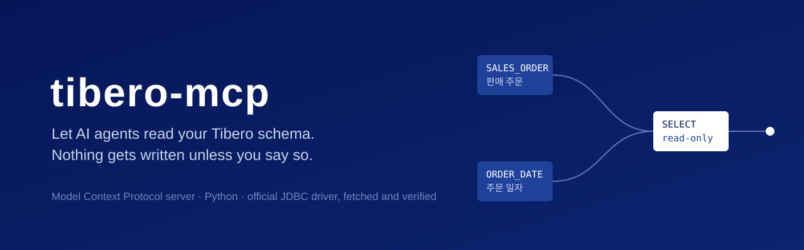

<p align="center">
  
</p>

<p align="center">
  <a href="https://github.com/jdk1021/tibero-mcp/actions/workflows/ci.yml"></a>
  
  
  
  <a href="LICENSE"></a>
</p>

<p align="center">
  <a href="https://jdk1021.github.io/tibero-mcp/">Website</a> ·
  <a href="README.ko.md">한국어</a> ·
  <a href="#quick-start">Quick start</a> ·
  <a href="#tools">Tools</a> ·
  <a href="SECURITY.md">Security</a>
</p>

---

**tibero-mcp** is a [Model Context Protocol](https://modelcontextprotocol.io) server that lets AI agents such as Claude Code, Codex and Cursor explore and query a **Tibero** database. It is built for the way agents actually work on enterprise and public-sector schemas: find the right table from a Korean comment, understand its keys, write a query, check the plan, and never change data by accident.

## Why tibero-mcp

**Safe by default.** Tibero ignores the JDBC read-only flag and has no `SET TRANSACTION READ ONLY`, so the server enforces it itself. Only `SELECT` and `WITH` run, one statement per call, `SELECT … FOR UPDATE` is refused, and every read is rolled back. The tool that writes does not even exist unless you turn writes on.

**Schema discovery that reads comments.** In many Tibero schemas the comments are the only documentation. Search tables and columns by comment (`주문`, `납기`), and get columns, primary, unique and foreign keys and indexes for a table in one call.

**Results an agent can use.** Typed JSON (numbers stay numbers, dates are ISO strings, LOBs are clipped), a hard row cap with a `truncated` flag and a `next_offset` to continue from, statement timeouts, execution plans as a readable tree, and errors that say what to try next.

**No driver hunting.** The official TmaxTibero JDBC driver ([`com.tmaxtibero:tbjdbc8`](https://central.sonatype.com/artifact/com.tmaxtibero/tbjdbc8), GPG-signed on Maven Central) is downloaded on first run, checked against a pinned SHA-1 and cached. No proprietary jar in this repository, no `CLASSPATH` to set.

**Ready to run alongside other agents.** stdio or Streamable HTTP, a connection that reconnects by itself, and a process that exits cleanly when the client goes away.

Verified against Tibero 6 using the 7.2.6 driver.

## Quick start

You need Python 3.12+, [uv](https://docs.astral.sh/uv/), Java 8+ and network access to Maven Central on first run.

1. Clone and configure

   ```bash
   git clone https://github.com/jdk1021/tibero-mcp.git
   cd tibero-mcp
   cp env.example .env    # host, dbname, user, password
   uv sync
   ```

2. Register with your client. Claude Code:

   ```bash
   claude mcp add -s user tibero -- uv --directory /path/to/tibero-mcp run tibero-mcp
   ```

   Claude Desktop, Cursor and other JSON-configured clients, passing settings as env instead of `.env`:

   ```json
   {
     "mcpServers": {
       "tibero": {
         "command": "uv",
         "args": ["--directory", "/path/to/tibero-mcp", "run", "tibero-mcp"],
         "env": {
           "TIBERO_HOST": "db.example.com",
           "TIBERO_PORT": "8629",
           "TIBERO_DBNAME": "tibero",
           "TIBERO_USER": "app_reader",
           "TIBERO_PASSWORD": "…"
         }
       }
     }
   }
   ```

3. Ask your agent something like *"Which tables hold order dates? Show the structure of the sales order table."*

To share one server between several agents, run it over HTTP and point clients at `http://127.0.0.1:8000/mcp`:

```bash
uv run tibero-mcp --transport streamable-http --port 8000
```

The HTTP transport has no authentication and binds to `127.0.0.1` by default. Keep it there, or put it behind something that authenticates.

## Tools

| Tool | What it does |
|---|---|
| `list_schemas` | Schemas with table and view counts; system schemas only on request |
| `list_tables` | Tables and views with comments and row estimates, filtered by text in the name **or comment**; paged |
| `describe_table` | Columns (type, nullability, default, comment), primary, unique and foreign keys, indexes |
| `search_columns` | Columns across a schema matched by name or comment, with full types such as `VARCHAR(20)`; narrow by table, paged |
| `query` | One `SELECT`/`WITH` with `?` bind parameters, a row cap and paging |
| `explain` | Execution plan as an indented tree, plus per-step cost, cardinality and predicates |
| `execute` | DML, DDL or a PL/SQL block, committed on success. **Registered only when `TIBERO_READ_ONLY=false`** |

## Configuration

| Variable | Default | Notes |
|---|---|---|
| `TIBERO_HOST` | | required |
| `TIBERO_PORT` | `8629` | |
| `TIBERO_DBNAME` | | required; database name (SID) |
| `TIBERO_USER`, `TIBERO_PASSWORD` | | required |
| `TIBERO_READ_ONLY` | `true` | `false` registers the `execute` tool |
| `TIBERO_MAX_ROWS` | `500` | upper bound per call |
| `TIBERO_QUERY_TIMEOUT` | `30` | seconds; `0` disables |
| `TIBERO_JDBC_JAR` | | use a driver jar you already have instead of downloading |
| `JAVA_HOME` | | pick a specific JDK or JRE |

Environment variables win over `.env` in the working directory. The driver is cached in `$XDG_CACHE_HOME/tibero-mcp` (default `~/.cache/tibero-mcp`).

## How read-only is enforced

| Layer | What it stops |
|---|---|
| Tool surface | No `execute` tool unless `TIBERO_READ_ONLY=false` |
| Statement check | Anything but `SELECT`/`WITH`; scripts with more than one statement; `FOR UPDATE` |
| Transaction | Every read ends in a rollback |
| Your account | Everything else. A function called from a `SELECT` can still write through an autonomous transaction, so **connect with an account that only has `SELECT` grants** |

## Development

```bash
uv sync
uv run ruff check . && uv run ruff format --check .
uv run pytest
```

Unit tests need neither a database nor a JVM. See [CONTRIBUTING.md](CONTRIBUTING.md).

## License

MIT for this project. The Tibero JDBC driver is distributed by TmaxTibero under its own license and is not included here. This project is not affiliated with or endorsed by TmaxTibero; Tibero is a trademark of TmaxTibero Co., Ltd.
